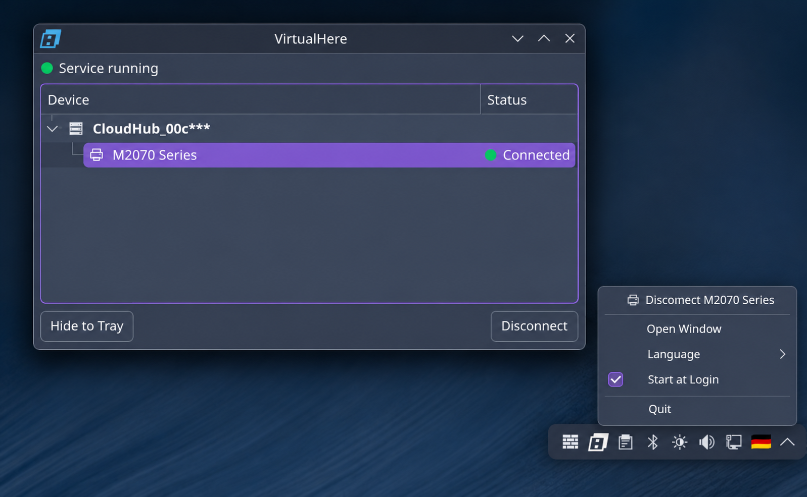

# VirtualHere Qt 0.1.1

[English](README.md) | [Deutsch](README.de.md) | [Русский](README.ru.md)

**Inoffizielles Qt-6-Frontend für den VirtualHere USB Client als systemd-Dienst unter Linux.**

Dieses unabhängige Projekt ist weder mit VirtualHere verbunden noch von VirtualHere offiziell empfohlen oder unterstützt.

> [!NOTE]
> **VirtualHere entdecken — USB over IP**
>
> Mit VirtualHere lassen sich USB-Geräte über ein lokales Netzwerk, das Internet oder die Cloud nutzen, als wären sie direkt am Computer angeschlossen. Der USB Server stellt physische Geräte bereit, während der USB Client sie vorhandenen Anwendungen und Treibern zugänglich macht. Das Originalprodukt unterstützt zahlreiche Serverplattformen sowie Clients für Windows, macOS und Linux.
>
> **[Offizielle VirtualHere-Website](https://www.virtualhere.com/)** · [USB-Server-Software](https://www.virtualhere.com/usb_server_software) · [USB-Client-Software](https://www.virtualhere.com/usb_client_software)
>
> **Release v0.1.1 — in Vorbereitung**
>
> Der Originalentwickler erteilte am 25. November 2026 die Genehmigung, den unveränderten Linux-x86_64-Client als Teil des Arch-Linux-Pakets weiterzugeben, das Originalsymbol und dessen monochrome Tray-Variante zu verwenden sowie den Namen VirtualHere Qt zu nutzen. Die Veröffentlichung erfolgt nach abschließenden Build- und Installationstests.



## Funktionen

- USB-Server und Geräte anzeigen, verbinden und trennen.
- Integration in die KDE-Plasma-Systemleiste, Autostart und Dienststatus.
- Grafische Oberfläche ohne Root-Rechte; Nutzung der offiziellen `-t`-API.
- Auto-Use für ausgewählte Geräte; Quit beendet nur die Oberfläche.
- Englisch, Deutsch und Russisch; Standardsprache Englisch.

## Plattform und Kompatibilität

Arch Linux x86_64, KDE Plasma, Wayland, Qt 6 (Paket gebaut mit Qt 6.12), qt6-wayland und systemd. Andere Umgebungen wurden nicht getestet.

## Installation und Aktualisierung

Das Installationspaket wird nach Abschluss der Tests unter [Releases](https://github.com/cyberkrel/virtualhere-qt/releases) verfügbar sein. Vor einer Aktualisierung **Quit** im Tray-Menü wählen. Nach der Installation **VirtualHere** erneut über das Plasma-Anwendungsmenü starten.

```bash
sudo pacman -U ./virtualhere-0.1.1-1-x86_64.pkg.tar.zst
```

Die Installation aktiviert oder startet den systemd-Dienst nicht automatisch. Läuft der Dienst bereits, verbindet sich die Oberfläche automatisch. Bei einer Neuinstallation den Dienst manuell aktivieren und starten:

```bash
sudo systemctl enable --now virtualhere.service
```

Den Dienst mit `systemctl status virtualhere.service` prüfen. VirtualHere als normaler Benutzer über das Anwendungsmenü starten.

## Originaler VirtualHere Client

Das geplante Paket enthält den unveränderten VirtualHere USB Console Client **6.0.3** für Linux x86_64 (1. Oktober 2026).

- SHA-1: `a5e9a489c811357a6eeda3213c172b9e80beab20`
- SHA-256: `d66d41a12e1137ce3adec1f851987a2bfb3cc62ca96a280646abcd6d9c4ec554`

Die SHA-1-Prüfsumme wurde am 25. November 2026 mit der vom Hersteller veröffentlichten Prüfsumme abgeglichen. Siehe [offizielle Downloads](https://www.virtualhere.com/usb_client_software) und [offizielle Prüfsummen](https://www.virtualhere.com/sites/default/files/usbclient/SHA1SUM).

Für eine manuelle Aktualisierung die neue Datei `vhclientx86_64` vom Hersteller herunterladen und ihre Prüfsumme mit der entsprechenden offiziellen Prüfsumme vergleichen. Anschließend den Dienst stoppen, die vorhandene ausführbare Datei außerhalb des Paketverzeichnisses sichern, die geprüfte Datei installieren und den Dienst neu starten:

```bash
sudo systemctl stop virtualhere.service
sudo cp -a /usr/lib/virtualhere/vhclientx86_64 /root/vhclientx86_64.backup
sudo install -m755 vhclientx86_64 /usr/lib/virtualhere/vhclientx86_64
sudo systemctl start virtualhere.service
```

Das Stoppen des Dienstes unterbricht USB-Verbindungen. Der manuelle Austausch verändert eine von Pacman verwaltete Datei, die bei einem Paketupdate überschrieben werden kann. Die Kompatibilität mit neueren Originalversionen ist nicht garantiert; ein Neubau des Pakets wird empfohlen.

## Aus dem Quellcode bauen

Das Repository klonen oder das Quellarchiv entpacken, sobald es verfügbar ist. Die Originalkomponenten gemäß [assets/README.md](assets/README.md) beziehen und im Verzeichnis mit PKGBUILD als normaler Benutzer ausführen:

```bash
sudo pacman -S --needed base-devel
makepkg --verifysource
makepkg -si
```

## Geplante Paketstruktur

```
/usr/
├── bin/virtualhere
├── lib/
│   ├── virtualhere/vhclientx86_64
│   └── systemd/system/virtualhere.service
└── share/
    ├── applications/virtualhere.desktop
    ├── icons/hicolor/128x128/apps/virtualhere.png
    ├── doc/virtualhere/
    │   ├── README.md
    │   ├── README.de.md
    │   └── README.ru.md
    └── licenses/virtualhere/
        ├── LICENSE
        └── NOTICE
```

Der Dienst speichert Verbindungseinstellungen und Auto-Use in `/var/lib/virtualhere/vhclient.conf`. Sprache und Fenstergeometrie: `~/.config/virtualhere/settings.ini`. Autostart: `~/.config/autostart/virtualhere.desktop`.

## Lizenz und Drittanbieterkomponenten

Der Daemon `vhclientx86_64` ist der unveränderte Originalclient von VirtualHere. Dieses Projekt stellt die Qt-Oberfläche, die Arch-Linux-Paketierung und die systemd-Integration bereit. Die 0BSD-Lizenz gilt nur für den eigenen Quellcode der Oberfläche. Originalclient und Symbol unterliegen ihren jeweiligen Lizenzbedingungen. Die Genehmigung zur Weitergabe im Arch-Linux-Paket sowie zur Nutzung der Grafiken und des Projektnamens wurde am 25. November 2026 erteilt. Siehe [NOTICE](NOTICE) (wird vor Veröffentlichung aktualisiert).

[Offizielle VirtualHere-Website](https://www.virtualhere.com/)
