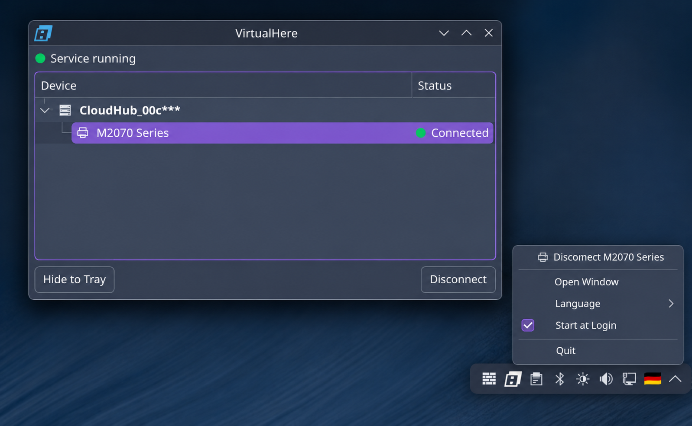

# VirtualHere Qt 0.1.1

[English](README.md) | [Deutsch](README.de.md) | [Русский](README.ru.md)

**An unofficial Qt 6 frontend for the VirtualHere USB Client running as a systemd service on Linux.**

This independent project is not affiliated with, endorsed by, or supported by VirtualHere.

> [!NOTE]
> **Release v0.1.1 — in preparation**
>
> Permission to redistribute the unmodified Linux x86_64 client as part of the Arch Linux package, use the original application icon and its monochrome tray adaptation, and use the name VirtualHere Qt was granted by the original developer on 25 November 2026. The release will be published after final build and installation testing.



## Features

- View USB servers and devices, connect and disconnect devices.
- KDE Plasma system tray integration, autostart and service status.
- No root privileges required for the graphical frontend; uses the official `-t` API.
- Auto-Use for selected devices; Quit closes only the frontend.
- English, German and Russian interface; English by default.

## Platform and Compatibility

Arch Linux x86_64, KDE Plasma, Wayland, Qt 6 (package built against Qt 6.12), qt6-wayland and systemd. Other environments have not been tested.

## Installation and Update

The installation package will be available under [Releases](https://github.com/cyberkrel/virtualhere-qt/releases) after final testing. Before updating, select **Quit** from the tray menu. After installation, launch **VirtualHere** again from the Plasma application menu.

```bash
sudo pacman -U ./virtualhere-0.1.1-1-x86_64.pkg.tar.zst
```

Installation does not automatically enable or start the systemd service. If the service is already running, the frontend connects automatically. On a fresh installation, enable and start it manually:

```bash
sudo systemctl enable --now virtualhere.service
```

Check the service with `systemctl status virtualhere.service`. Launch VirtualHere from the application menu as a regular user.

## Original VirtualHere Client

The planned package contains the unmodified VirtualHere USB Console Client **6.0.3** for Linux x86_64 (1 October 2026).

- SHA-1: `a5e9a489c811357a6eeda3213c172b9e80beab20`
- SHA-256: `d66d41a12e1137ce3adec1f851987a2bfb3cc62ca96a280646abcd6d9c4ec554`

The SHA-1 was checked against the manufacturer's published checksum on 25 November 2026. See [official downloads](https://www.virtualhere.com/usb_client_software) and [official checksums](https://www.virtualhere.com/sites/default/files/usbclient/SHA1SUM).

For a manual client update, download the new `vhclientx86_64` from the manufacturer and verify its checksum against the corresponding official checksum before proceeding. Stop the service, back up the existing executable outside the package directory, install the verified file and restart the service:

```bash
sudo systemctl stop virtualhere.service
sudo cp -a /usr/lib/virtualhere/vhclientx86_64 /root/vhclientx86_64.backup
sudo install -m755 vhclientx86_64 /usr/lib/virtualhere/vhclientx86_64
sudo systemctl start virtualhere.service
```

Stopping the service interrupts USB connections. Manual replacement changes a Pacman-managed file and may be overwritten by a package update. Compatibility with newer upstream versions is not guaranteed; rebuilding the package is preferred.

## Building from Source

Clone the repository or extract the source archive once available. Obtain the original components as described in [assets/README.md](assets/README.md), then run the following in the directory containing PKGBUILD as a regular user:

```bash
sudo pacman -S --needed base-devel
makepkg --verifysource
makepkg -si
```

## Planned Package File Layout

```
/usr/
├── bin/virtualhere
├── lib/
│   ├── virtualhere/vhclientx86_64
│   └── systemd/system/virtualhere.service
└── share/
    ├── applications/virtualhere.desktop
    ├── icons/hicolor/128x128/apps/virtualhere.png
    ├── doc/virtualhere/
    │   ├── README.md
    │   ├── README.de.md
    │   └── README.ru.md
    └── licenses/virtualhere/
        ├── LICENSE
        └── NOTICE
```

The service stores connection settings and Auto-Use preferences in `/var/lib/virtualhere/vhclient.conf`. Language and window geometry: `~/.config/virtualhere/settings.ini`. Autostart: `~/.config/autostart/virtualhere.desktop`.

## License and Third-Party Components

The daemon `vhclientx86_64` is the original, unmodified client provided by VirtualHere. This project provides the Qt frontend, Arch Linux packaging and systemd integration. The 0BSD license applies only to the frontend's own source code. The original client and icon remain subject to their respective licensing terms. Redistribution permission for the Arch Linux package and use of the graphics and project name was granted on 25 November 2026. See [NOTICE](NOTICE) (to be updated before release).

[Official VirtualHere website](https://www.virtualhere.com/)
