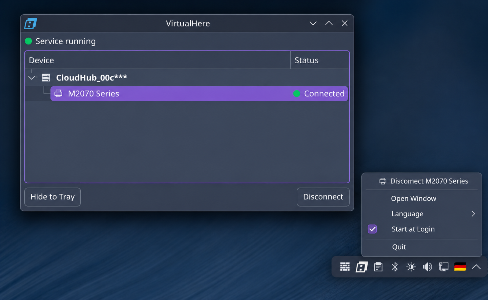

# VirtualHere Qt 0.1.1

[English](README.md) | [Deutsch](README.de.md) | [Русский](README.ru.md)

**Неофициальный интерфейс Qt 6 для VirtualHere USB Client, работающего как служба systemd в Linux.**

Независимый проект, не связанный с VirtualHere и не поддерживаемый производителем.

> [!IMPORTANT]
> **Статус релиза — ожидается разрешение**
>
> Первый публичный релиз, содержащий оригинальный VirtualHere USB Console Client и иконку приложения, будет опубликован только после получения явного разрешения от разработчика оригинальной программы. До этого репозиторий служит для презентации проекта и ознакомления с документацией. Установочный пакет остаётся неопубликованным.



## Возможности

- Просмотр USB-серверов и устройств, подключение и отключение.
- Системный трей KDE Plasma, автозапуск и состояние службы.
- Интерфейс без root, управление через официальный API `-t`.
- Auto-Use для выбранных устройств; Quit завершает только интерфейс.
- English, Deutsch, Русский; по умолчанию английский.

## Платформа

Arch Linux x86_64, KDE Plasma, Wayland, Qt 6 (пакет собран под Qt 6.12), qt6-wayland и systemd. Другие окружения не протестированы.

## Установка и обновление

Установочный пакет пока не опубликован. Перед обновлением выберите Quit в трее, после установки откройте VirtualHere из меню Plasma.

```bash
sudo pacman -U ./virtualhere-0.1.1-1-x86_64.pkg.tar.zst
```

При работающей службе интерфейс подключится автоматически. На чистой системе:

```bash
sudo systemctl enable --now virtualhere.service
```

## Пересборка

После публикации архива исходников распакуйте его и выполните в каталоге с PKGBUILD от обычного пользователя:

```bash
sudo pacman -S --needed base-devel
makepkg -si
```

## Карта файлов

```
/usr/
├── bin/virtualhere
├── lib/
│   ├── virtualhere/vhclientx86_64
│   └── systemd/system/virtualhere.service
└── share/
    ├── applications/virtualhere.desktop
    ├── icons/hicolor/128x128/apps/virtualhere.png
    ├── doc/virtualhere/README.ru.md
    └── licenses/virtualhere/
        ├── LICENSE
        └── NOTICE
```

Служба хранит настройки подключения и Auto-Use в `/var/lib/virtualhere/vhclient.conf`. Язык и геометрия окна: `~/.config/virtualhere/settings.ini`. Автозапуск: `~/.config/autostart/virtualhere.desktop`.

## Лицензия и сторонние компоненты

Демон `vhclientx86_64` — неизменённый оригинальный клиент производителя. Наш проект предоставляет интерфейс Qt, упаковку для Arch Linux и интеграцию systemd. 0BSD относится только к собственному коду интерфейса; оригинальный клиент и иконка подчиняются своим условиям лицензирования. Право распространения ещё проверяется.

[Официальный сайт VirtualHere](https://www.virtualhere.com/)
